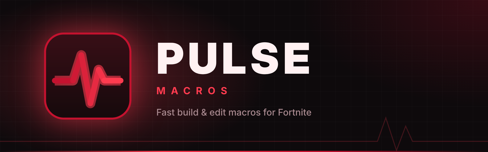

  

  
  
  

  
   
  Windows 10 &amp; 11 (64-bit) · Free · Updates itself

---

## ⚡ Macros

| | |
|---|---|
| **Drag Edit** | Hold Edit and sweep your mouse across the tiles. Let go and the edit confirms |
| **Double Edit** | Hold a key to keep editing and confirming until you let go |
| **Single Edit** | One key press opens the edit and selects, in one go |
| **Instant Build** | Your wall, floor, stair or cone goes down the moment you pick it |
| **Sprint Build** | Keeps you sprinting while you build |
| **Spam Crouch** | Hold a key to crouch over and over |
| **Zenn Mantle** | Hold a key to jump and spam floor + wall |
| **Item Pullout** | Your gun comes straight out every time you let go of Edit |
| **Macro Builder** | Make your own macros, step by step: tap, hold, release and wait |

## 🎛️ Everything else

- **F8 on/off** with an on-screen overlay, so you always know if macros are running
- **Game focus.** Macros only work while you're in the Fortnite window, so they never fire while you type in Discord
- **Profiles** for different setups, with a hotkey to switch between them
- **Keyboard Tweaks.** Key remaps, faster key repeat, and no Sticky Keys popup mid-game
- **Dashboard** showing your stats and activity
- **Themes:** Red, Blue and Purple
- **Auto-update.** A banner shows when a new version is out, and one click installs it

## 📥 Install

1. Click **Download for Windows** above
2. Under **Assets**, download **`PULSE-Setup-x.x.x.exe`** (you don't need the "Source code" files)
3. Run it. If Windows says *"Windows protected your PC"*, click **More info**, then **Run anyway**
4. Click **Yes** when it asks for admin. PULSE needs this so the macros work in-game
5. Open PULSE and follow the quick setup

## ❓ Help

**Macros don't work in-game?** Check the overlay says **ON** (press **F8**) and that your binds in PULSE match your Fortnite binds.

**Still stuck?** Ask in our [Discord](https://discord.gg/3PBA6DtNku).

---

  Only download PULSE from this page or our Discord. Never run a PULSE file someone sends you in a DM. 
  PULSE is not affiliated with or endorsed by Epic Games. Use macros at your own risk.

